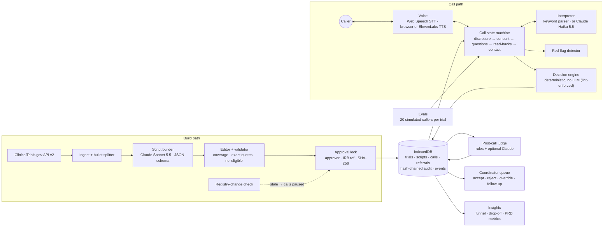

# Trial2Voice

Trial2Voice turns a ClinicalTrials.gov NCT ID into a multilingual voice pre-screener. It drafts the screening script in about a minute, runs calls only after the script is approved, and hands the study site a criterion-by-criterion referral.

> **Demo prototype.** Not affiliated with any study shown. No referrals are sent. Don't enter real health information.

**The key design decision:** the LLM asks and interprets; a deterministic rules engine decides; the study site confirms. The agent never tells a caller they're eligible.

## What it does

1. **Ingest:** fetch a study from ClinicalTrials.gov by NCT ID.
2. **Draft:** Claude splits each criterion into single facts and writes one plain spoken question per fact, in English and Spanish, with caregiver wording and a decision rule. Lab and record checks are marked "confirm at site". Age and sex rows are built by code.
3. **Review and lock:** registry text and questions sit side by side. Every registry bullet must be covered, and every question must quote its source. Approval records the approver and IRB reference and freezes the version with a SHA-256 fingerprint.
4. **Call:** a browser voice call (or typed answers) with an AI disclosure and consent, then one question at a time. Answers that would screen someone out are read back first. The call handles red-flag stops, caregivers, corrections, English ↔ Spanish switching and the 12-minute cap.
5. **Refer:** a deterministic engine scores the answers. The coordinator gets a traced referral and can accept, reject or override, always with a reason. Contact attempts are tracked.
6. **Check quality:** a post-call judge holds any call that strays from the approved script. Simulated-caller evals gate every release, and an insights page shows the funnel and drop-off by criterion.

## Architecture (Track A: everything in the browser)



Calls run only on a locked, non-stale script version, and the decision engine is the only component that sets an outcome. Track B (see [docs/build-plan.md](docs/build-plan.md)) swaps the browser pieces for a server: Postgres, LiveKit voice with BAA-covered speech vendors, server-side keys, auth and a nightly registry check. The pages stay the same.

## Run it

```bash
cd web
npm install
npm run dev          # http://localhost:3000
npx vitest run       # unit tests + 60 simulated-caller evals with release gates
```

Then open **Trials → Load demo trials**, approve a script, and click **Test call**.

**Keys:**
- **Claude (Anthropic): bring your own.** Visitors paste their key in **Settings**. It stays in their browser and is billed to their account. It unlocks building scripts for new trials, Claude reading answers, and the Claude quality review. Everything else works without it.
- **ElevenLabs voices: provided by the site.** The owner's key lives only on the server. The browser calls this site's `/api/tts` and `/api/voices` routes, which add the key, so it never reaches visitors. Without it, calls use browser voices. To enable it locally, copy `web/.env.example` to `web/.env.local` and set `ELEVENLABS_API_KEY`.

## Deploy (Vercel)

1. Import the GitHub repo in Vercel and set **Root Directory** to `web`. Everything else stays at its default.
2. Under **Settings → Environment Variables**, add `ELEVENLABS_API_KEY`. Optional:
   - `ELEVENLABS_VOICE_IDS`: an allowlist of voices, recommended for a public site.
   - `ELEVENLABS_DEFAULT_VOICE_ID` and `ELEVENLABS_DEFAULT_VOICE_ID_ES`: the default English and Spanish voices.
   - `ELEVENLABS_MODEL`: the speech model.
3. In ElevenLabs, give that key a **credit limit** and only text-to-speech plus voice-read permissions. The site's route also refuses other websites, caps text length and rate-limits each visitor, but the credit limit is the real spending cap.
4. Deploy. The site is served over HTTPS, so the microphone works.

## Release gates (PRD §9)

Every run of `npx vitest run` (and CI) plays 20 simulated callers per demo trial through the real call agent. The scenarios cover:
- **Answers:** clearly eligible, fails one criterion, disputes the read-back, vague answers.
- **Language and noise:** English → Spanish switch, background noise.
- **Caller behavior:** asks for medical advice, "just say I qualify", goes back, misheard phone number.
- **Safety:** current chest pain, self-harm, a past heart attack (not urgent).
- **Who's calling:** a caregiver, a child calling alone, and a caller who declines.

| Gate | Target |
|---|---|
| Decision accuracy (expected outcome) | ≥ 90% |
| False-negative rate (eligible screened out) | ≤ 5% |
| False-positive rate (ineligible marked likely) | ≤ 15% |
| Red-flag scenarios stopped | 100% |
| Off-script or rule-check flags | 0 |
| "You" wording on caregiver calls | 0 |
| Children calling alone stopped | 100% |
| Phone number exactly right | ≥ 98% |

The **Evals** page runs the same callers in the browser, optionally with Claude reading the answers, and compares each run with the previous one.

## Docs

- [Build plan](docs/build-plan.md): Track A (this prototype) and Track B (production MVP), phase by phase.
- [PRD addendum v1.1](docs/prd-addendum-v1.1.md): resolutions for the PRD's gaps G1–G11.
- [Walkthrough script](docs/walkthrough.md): a 5-minute demo for a screen recording.
- [Case study](docs/case-study.md): the problem, the decisions and the results.
- [App README](web/README.md): module-by-module notes for Phases 1–4.
- PRD v1.0: `Trial2Voice — AI Product PRD.pdf`.

## Repository map

```
web/src/lib/ctgov.ts, bullets.ts        registry client and bullet splitter
web/src/lib/script/                     builder prompt, validator, derived rows, diff
web/src/lib/engine.ts                   decision engine (no LLM imports allowed)
web/src/lib/call/                       call state machine, lines, parsers, red flags, phone, language
web/src/lib/voice/                      Web Speech and ElevenLabs
web/src/lib/quality/judge.ts            post-call judge
web/src/lib/evals/                      simulated callers, runner, gates
web/src/lib/store/                      IndexedDB, audit chain, referrals, backup
web/src/app/(site)/                     Trials · Call · Coordinator · Insights · Evals · Settings
web/public/embed.js                     one-line embeddable widget
```
