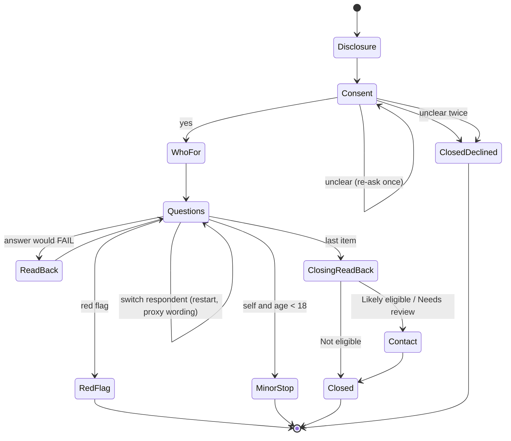
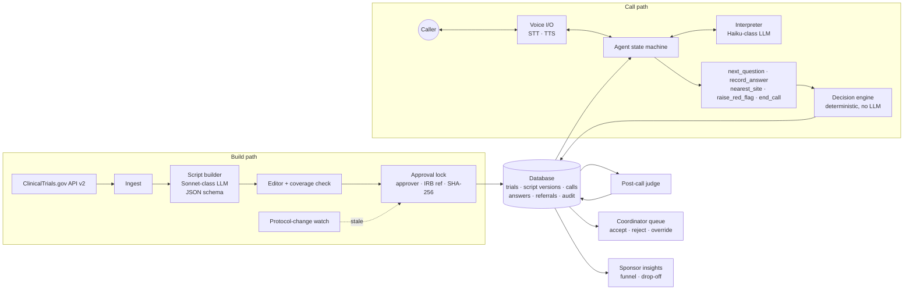

# Trial2Voice — PRD Addendum v1.1: Gap Resolutions

Amends: *Trial2Voice — AI Product PRD* v1.0 (Nov 1, 2026)
Status: Draft for review · Owner: Sankar Kumar Palaniappan

v1.0 left nine points open that block implementation. While resolving them, two more gaps turned up (G10, G11). Each resolution below is binding for the build. Where it changes v1.0 text, the "PRD change" line says exactly how.

Core principle unchanged: **the LLM asks and interprets; the deterministic engine decides; the site confirms.**

| # | Gap | Resolution in one line | PRD sections changed |
|---|-----|-----------------------|----------------------|
| G1 | Decision-rule format undefined | Typed criterion schema; rules are data, never prose or code | §4, §6, §11 |
| G2 | When an answer may screen someone out | FAIL only on a confident answer the caller confirmed on read-back; read-back on **every** screen-out answer | §4, §7 |
| G3 | "Likely eligible" vs. confirm-at-site items | Likely eligible = every asked item passes; site items listed as pending | §4, §7 |
| G4 | Age and sex: ask or derive | Ask age; ask sex only if restricted; ranges handled deterministically | §4 |
| G5 | Consent declined, silence, hang-up | Defined states, timeouts and what gets stored | §4, §13 |
| G6 | "Go back" semantics | Step-wise undo; old answer kept in audit as superseded | §13 |
| G7 | Verbatim vs. alternate phrasings | Up to 2 approved alternates + approved glossary; `verbatimOnly` per trial | §6, §7 |
| G8 | Architecture diagram not in text | Mermaid diagram below | §11 |
| G9 | Red-flag list undefined | 6 categories, two-layer detection, "happening now?" check, fixed messages | §7 |
| G10 | Caregiver callers not handled *(new)* | Who-for question, proxy wording for every line, minors stopped, patient-permission banner | §2, §4, §9, §13 |
| G11 | No contact capture, so the site can't call back *(new)* | Opt-in name + phone (digit read-back) + voicemail OK, referrals only; redacted, separate store; follow-up workflow | §3, §4, §5, §9, §10, §13 |

---

## G1 — Criterion and decision-rule schema

**Decision.** Every screening item is a `Criterion` record. The engine runs only the `rule` field. The script builder must produce this shape through JSON-schema tool output; anything that fails validation is rejected, not repaired.

```ts
type Criterion = {
  id: string;                         // "IN-01", "EX-03" — stable across versions
  kind: 'inclusion' | 'exclusion';
  sourceText: string;                 // exact registry sentence(s) it came from
  mode: 'ask' | 'confirm_at_site';
  question:      { en: string; es: string };     // "you" form
  questionProxy: { en: string; es: string };     // caregiver form (G10)
  altPhrasings:  { en: string[]; es: string[] }; // max 2 each (G7)
  answerType: 'yes_no' | 'number' | 'enum' | 'months_ago';
  unit?: 'years' | 'months' | 'kg' | 'lb' | 'cm';
  enumOptions?: string[];
  rule: Rule;                         // the PASS condition
  readBackText: { en: string; es: string };     // template, e.g. "So {answer} — is that right?"
  readBackTextProxy: { en: string; es: string }; // caregiver form (G10)
  groupId?: string;                   // for OR-clauses, see below
};

type Rule =
  | { op: 'eq' | 'neq'; value: string | number | boolean }
  | { op: 'lt' | 'lte' | 'gt' | 'gte'; value: number }
  | { op: 'between'; min: number; max: number }        // inclusive
  | { op: 'in' | 'not_in'; values: string[] };

type CriterionGroup = { id: string; logic: 'any'; criterionIds: string[] };
```

**Rules for the builder (validated in code):**

1. One criterion = one fact. "No MI or stroke in 6 months" becomes two criteria.
2. OR-clauses ("HbA1c ≥ 7% **or** on insulin") become a `CriterionGroup` with `logic: 'any'`: the group passes if any member passes, fails only if all members fail.
3. Anything that needs a lab value, imaging, a record, or a clinician's judgment → `mode: 'confirm_at_site'`, with no question.
4. Every registry bullet must map to at least one criterion. The editor shows a coverage bar and blocks approval below 100%.
5. `sourceText` must be a substring of the registry eligibility text (checked in code) so every question traces back to the registry.

**Examples**

| Registry text | Result |
|---|---|
| "Age 18–75" | `IN-01`, number, years, `between 18 75` |
| "Diagnosed with type 2 diabetes" | `IN-02`, yes_no, `eq true` |
| "HbA1c 7.0–10.5%" | `IN-03`, `confirm_at_site` |
| "Cardiac surgery within the past 6 months" | `EX-01`, months_ago, `gt 6` (pass = more than 6 months ago, or never) |
| "Currently pregnant or breastfeeding" | `EX-02a` pregnant `eq false`, `EX-02b` breastfeeding `eq false` |

`months_ago` answers accept "never" as `Infinity`, which passes any `gt` rule.

**PRD change.** §4 "Script builder": "…with answer type and decision rule *in the v1.1 criterion schema (Addendum G1)*." §11: the decision engine consumes only `Criterion.rule` and structured `Answer.value`.

---

## G2 — When an answer can screen someone out

**Problem.** v1.0 requires read-back on exclusion answers only. But a "no" to an *inclusion* question ("Have you been diagnosed with type 2 diabetes?") screens a caller out just as hard. Speech recognition errors on "yes"/"no" and negations are the most likely route to a false negative.

**Decision.**

1. **Read-back on every answer that would produce FAIL**, inclusion or exclusion. Passing answers are not read back individually; they are covered by the closing read-back.
2. An item is **FAIL** only when all three hold: the rule fails, `confidence ≥ threshold`, and the caller confirmed the read-back.
3. Read-back outcomes:
   - Caller confirms → `readBackConfirmed = true`.
   - Caller corrects → re-ask the question once, re-interpret.
   - Second answer still ambiguous or contradicts → **UNSURE**.
4. Confidence threshold default **0.80**; configurable per trial between 0.70 and 0.95, and part of the locked script.
5. The call **continues after a confirmed FAIL**, so the site sees the full picture and the sponsor gets complete drop-off data. A per-trial setting `stopOnConfirmedFail` (default `false`) allows ending early.
6. **All completed calls go to the coordinator queue**, including Not eligible, in a separate tab. Coordinators sample Not-eligible calls weekly to measure the false-negative rate in production.

**Engine (final):**

```
per criterion:
  mode = confirm_at_site                    → SITE_CHECK
  no answer | value = UNSURE                → UNSURE
  confidence < threshold                    → UNSURE
  rule passes                               → PASS
  rule fails and readBackConfirmed          → FAIL
  rule fails and not readBackConfirmed      → UNSURE

per group (logic any):
  any member PASS                           → PASS
  all members FAIL                          → FAIL
  otherwise                                 → UNSURE (or SITE_CHECK if all remaining are SITE_CHECK)

call:
  any FAIL                                  → NOT_ELIGIBLE
  else any UNSURE                           → NEEDS_SITE_REVIEW
  else                                      → LIKELY_ELIGIBLE
```

**Closing lines (caller never hears "eligible" or "not eligible"):**

| Decision | Closing line (EN) |
|---|---|
| Likely eligible | "Based on your answers, you may be a fit. The study team at [site] will contact you within [N] business days to confirm." |
| Needs site review | "Thank you. A few answers need the study team to check. They'll contact you within [N] business days." |
| Not eligible | "Thank you for your time. From your answers, this study may not be a match. The study team reviews every call and will reach out if that changes." |

**PRD change.** §4 "Voice pre-screen call": "read-back on exclusion answers" → "read-back on every answer that would screen the caller out". §7 Detection: same. §3: add "Not-eligible sample review" as the production source for the false-negative guardrail.

---

## G3 — "Likely eligible" when site checks remain

**Decision.** Nearly every trial has lab or record criteria, so "Likely eligible" means: **every asked item passed; no item was unsure; confirm-at-site items are still pending.**

The referral header shows:

> **Likely eligible — pre-screen** · 9 of 9 asked criteria passed · 3 to confirm at site (HbA1c, eGFR, prior medication records)

If a script has more `confirm_at_site` items than `ask` items, the editor warns the approver ("This pre-screen can only check a minority of criteria"). It doesn't block approval.

**PRD change.** §4 "Deterministic decision engine": add the definition above. §4 "Referral summary": add the header line.

---

## G4 — Age and sex

**Decision.**

- **Age:** always asked when the registry has a min or max age. "How old are you?" → number in years. Checked against `minimumAge` / `maximumAge` from the API (converted to years).
  - Ranges ("in my sixties") → if the whole range is inside the limits, PASS; if the whole range is outside, FAIL candidate (goes to read-back); if it straddles a limit, re-ask once for the exact age, then UNSURE.
  - Registry "N/A" limits → no check on that side.
- **Sex:** asked only if the registry `sex` is `FEMALE` or `MALE`. Wording: "This study is for people assigned [female] at birth. Does that apply to you?" (yes_no). "Prefer not to say" → UNSURE. If the registry has `genderBased: true` with a gender description, the item becomes `confirm_at_site`.
- Age and sex are generated by code from the structured API fields, not by the LLM, and appear in the editor as locked "registry-derived" rows.

**PRD change.** §4 "NCT ID ingest": add "age and sex criteria generated deterministically from structured fields."

---

## G5 — Consent declined, silence, hang-up

**Call states.**



| Event | Behavior | What is stored |
|---|---|---|
| Consent "no" | "No problem. You can call back anytime. Goodbye." | Funnel event only. **No transcript, no audio.** |
| Consent unclear | Re-ask once; second unclear → treated as no | Funnel event only |
| Silence 8 s | "Are you still there? Take your time." | — |
| Silence after 2 reprompts | "I'll end the call for now. You can call back anytime." | Call `incomplete`, answers so far |
| Caller hangs up mid-call | — | Call `incomplete`, answers so far, decision **not** computed, **not** sent to the queue (no contact details, G11) |
| 12-minute cap | At 11:00: "We're almost out of time." At 12:00: close as incomplete | Call `capped` |
| Self caller under 18 | Stop with the parent/guardian line (G10) | Call `minor_self`, funnel event only |
| Caller asks for a human | "I can't transfer calls, but the study team's number is [site phone]." Continue if they want | Implicit signal logged |

Recording and screening consent are one question in the MVP (as in the v1.0 opening). Declining recording means declining the call.

**PRD change.** §13: add the state diagram and table. §4 "Call console": status values `consent_declined | incomplete | capped | red_flag | minor_self | completed`.

---

## G6 — "Go back" and corrections

**Decision.**

- "Go back" / "change my last answer" → the previous criterion is re-asked. Repeated "go back" walks back one step at a time, to the first question at most.
- The old answer stays in the audit log with `supersededBy` pointing to the new one. The engine only uses the latest non-superseded answer.
- At the closing read-back, the agent summarizes key answers in one or two sentences. If the caller says something is wrong ("no, I said 62"), the interpreter maps it to the criterion and re-asks just that one.
- Coordinator overrides (v1.0 §13) work the same way: new value, required reason, old value kept.

**PRD change.** §13 "Edit and override": "go back to change the last answer" → "go back one step at a time; any correction at the closing read-back re-asks that item; superseded answers are kept in the audit log."

---

## G7 — Verbatim questions vs. alternate phrasings

Resolves the build side of Open Question 3. The IRB answer still decides which mode a pilot uses.

**Decision.**

- Each criterion may have **up to 2 approved alternate phrasings per language**. They are written by the builder, edited by a human, and **locked with the script** (included in the SHA-256).
- Each script may have an **approved glossary**: `{ term, plainDefinition }[]` for medical terms in the questions ("myocardial infarction — a heart attack").
- When the caller asks to repeat → same question, slower speech rate. Asks to clarify → next alternate phrasing, then glossary definition. After that: "That's a good question for the study team. Would you like to answer, or say 'not sure'?"
- Per-trial flag `verbatimOnly`. When on, alternates and glossary are disabled: repeat = same text, slower.
- The post-call judge flags any agent turn that isn't the question, an approved alternate, a glossary entry, or a fixed line.

**PRD change.** §6 Approach: "the prompt holds the script *including approved alternates and glossary*". §7 Prevention: replace "pre-approved alternate phrasings" with a reference to this section.

---

## G8 — Architecture diagram (text version)

Replaces the image in §11.



The call path can read only **locked, non-stale** script versions. The decision engine is the only component that writes a `Decision`.

---

## G9 — Red-flag list and handling

**Categories (v1.1).**

| # | Category | Example triggers | Message |
|---|---|---|---|
| 1 | Chest pain / heart attack signs | "chest pain right now", "pressure in my chest" | Emergency |
| 2 | Breathing trouble | "can't breathe", "struggling to breathe" | Emergency |
| 3 | Stroke signs | "face drooping", "can't move my arm", "slurred speech" | Emergency |
| 4 | Severe bleeding / injury / overdose | "bleeding a lot", "took too many pills" | Emergency |
| 5 | Self-harm or suicidal thoughts | "want to end my life", "hurt myself" | Crisis |
| 6 | Severe acute distress | "I'm having a severe reaction", "I'm passing out" | Emergency |

**Detection (two layers, run on every caller turn).**

1. **Keyword layer** (deterministic, EN + ES lists, runs first, no network). High recall by design.
2. **Classifier layer** (in-call LLM): labels the turn `none | historical | current | unclear` per category.

**Decision logic.**

- Self-harm (category 5): any hit on either layer → stop immediately. No follow-up question.
- Other categories: classifier `current` → stop. `historical` ("I had a heart attack in 2019") → no stop; treated as an answer. `unclear`, or keyword hit with no classifier (keyless mode) → ask one fixed question: "Is this happening to you right now?" Yes or unclear → stop.

**Fixed messages (pending IRB-approved wording — placeholders):**

- Emergency (EN): "I need to stop the questions. If this is happening now, please hang up and call 911 or go to the nearest emergency room."
- Crisis (EN): "I need to stop the questions. You can call or text 988 to reach the Suicide & Crisis Lifeline any time. If you're in danger now, call 911."
- Spanish versions required before Spanish goes live.

**After a stop:** screening never resumes on that call. Call status `red_flag`; the transcript is held for the site with a red-flag badge; no decision is computed. Eval gate: 100% of red-flag scenarios stop the call (v1.0 §9); 0 stops on the "historical mention" scenarios is tracked but not a gate.

**PRD change.** §7 "Red flags": replace with this section. §9: add "historical mention" persona.

---

## G10 — Caregiver and proxy callers *(new gap)*

**Problem.** §2 names "patient or caregiver" as the caller, but every question, read-back and closing line is written to "you". A daughter calling for her father would be asked about her own diagnosis, and the answers would describe the wrong person. Pediatric trials make this the normal case, not the exception.

### Decisions

**1. Who-for question (right after consent).**

| Trial type | Question (EN) | Question (ES) |
|---|---|---|
| Adult or all ages | "Are you answering these questions for yourself, or for someone else, like a family member you help care for?" | "¿Va a responder estas preguntas por usted mismo o por otra persona, como un familiar que usted cuida?" |
| Pediatric only (registry max age < 18) | "Are you a parent or guardian calling for a child?" | "¿Es usted el padre, la madre o el tutor de un niño y llama por él?" |

Interpreted as `self | proxy | unclear`. Unclear → re-ask once. Unclear twice → continue with "you" wording, `respondent = 'unclear'`, shown on the referral.

**2. Relationship (proxy only).** "What is your relationship to them?" → `parent_guardian | spouse_partner | adult_child | other_family | friend_caregiver | legal_representative | other`. "Prefer not to say" is accepted as `other`.

**3. Proxy wording.** Every caller-facing line has a proxy version, generated by the builder and approved with the script (part of the SHA-256):

| Item | Self | Proxy |
|---|---|---|
| Question | "Have you been diagnosed with type 2 diabetes?" | "Has the person you're calling for been diagnosed with type 2 diabetes?" |
| Read-back | "So you have not been diagnosed with type 2 diabetes — is that right?" | "So they have not been diagnosed with type 2 diabetes — is that right?" |
| Closing (likely) | "…you may be a fit." | "…the person you're calling for may be a fit." |

Rules: gender-neutral ("they"); never ask for or use the patient's name during the screen; the editor shows a Self / Proxy toggle per row, and approval is blocked while any proxy field is empty.

**4. Minors calling for themselves.** If `respondent = self` and the age answer is under 18:
> "Thanks for calling. For anyone under 18, a parent or guardian needs to do this call. They can call this number anytime."

Screening stops. Call status `minor_self`. No contact capture, no referral, funnel event only (same storage rule as consent declined).

**5. Switching mid-call.** "Actually, this is for my mom" → interpreter intent `switch_respondent` → agent confirms ("Just to check — should I ask about your mother instead of you?") → on yes, the relationship question is asked, all earlier answers are marked superseded (they described the wrong person), and questions restart from the first item in proxy wording. One switch per call; a second switch request → "Let's start a new call so the answers stay clear," and the call closes as `incomplete`.

**6. Unknown answers.** "I don't know" from a proxy is expected and maps to UNSURE like any other. The Needs-site-review rate will be higher for proxy calls; it's tracked by respondent type and doesn't count as a quality problem.

**7. Red flags in proxy calls.** Detection is the same (G9) whether the symptom is the caller's or the patient's. Message variant: "If this is happening to you or the person you care for right now, please hang up and call 911…"

**8. Permission of the patient.** The caller consents to the call; they can't consent on the patient's behalf to research contact. Every proxy referral carries a banner: **"Proxy call — confirm the patient's (or legal representative's) permission before scheduling."** The site does this on its first call back. This wording is added to the IRB package.

**9. Decision engine is unchanged.** Respondent type never affects a rule result.

### Metrics, evals, acceptance

- **Track:** share of proxy calls per trial; Needs-review rate and completion rate split by respondent.
- **Eval personas (added to §9):** adult child for parent; parent for child in a pediatric trial; 16-year-old calling for themselves; mid-call switch; proxy reporting the patient's current chest pain.
- **Acceptance:** 100% of proxy calls use only proxy wording after the who-for answer (judge check); 100% of `minor_self` personas stop before the second question; mid-call switch supersedes every earlier answer.

**PRD change.** §2: add respondent type and relationship. §4: add "who-for question and proxy wording" to the voice pre-screen call (P0). §13 Opening: insert the who-for question after consent. G1 schema: `questionProxy`, `readBackTextProxy`. §9: add the five personas.

---

## G11 — Contact capture for referrals *(new gap)*

**Problem.** The closing line promises "the study team will contact you within N business days", but v1.0 never collects a name or a number. A referral the site can't act on is worth nothing, and the North Star (site-accepted referral rate) can't be measured.

### Decisions

**1. When it's asked.** Only on completed calls whose decision is **Likely eligible** or **Needs site review**, after the closing read-back and before the closing line.

| Call outcome | Contact capture? | Caller is given |
|---|---|---|
| Likely eligible / Needs site review | Yes (opt-in) | Closing line with N business days |
| Not eligible | No | Site phone number |
| Incomplete, capped, consent declined, `minor_self` | No | Site phone number (when the call reaches a close) |
| Red flag | No | Emergency / crisis message only |

**2. The ask.**
- Self: "Would you like the study team to call you about next steps? If so, I'll need your first name and a phone number."
- Proxy: "Would you like the study team to call you about next steps for the person you're calling for?"
- Spanish versions approved with the script.

**3. Fields, in order.**

| Field | Required | Notes |
|---|---|---|
| Consent to be contacted | Yes | Explicit "yes" recorded with timestamp and the script version of the wording |
| First name (the caller's) | Yes | Read back once; low STT confidence → "Could you spell that for me?" |
| Phone number | Yes | US 10-digit, see rule 4 |
| OK to leave a voicemail that mentions the study | Yes (yes/no) | "If we miss you, is it OK to leave a message that mentions this study?" Protects privacy on shared phones |
| Best time to call | No | morning / afternoon / evening / any |
| Preferred language | Auto | From the call language; confirmed in one line |
| ZIP code | Only if nearest site not yet set | For routing to the right site |

Not collected: patient's name (proxy calls), date of birth, address, email (voice capture of emails is error-prone; text-input mode may offer an optional email field).

**4. Phone number capture.**
- Normalize spoken digits in both languages ("five five five", "oh" → 0, "double two" → 22, "cinco cinco cinco").
- Validate with libphonenumber (US). Invalid length → "I got fewer digits than I expected. Could you say the full number again?"
- Read back in groups: "I have 5 5 5 — 1 2 3 — 4 5 6 7. Is that right?" Digits are read one by one, in the call language.
- Wrong → re-ask once. Wrong again → show a number field on screen ("You can also type it here"). Still no valid number → `no_contact`, and the agent reads the site's phone number.
- The agent never fills in or guesses digits, and never says "got it" before the read-back is confirmed.

**5. Declines.** "That's fine. You can reach the study team at [site phone]." The referral is still created, marked `no_contact`, so the site sees it and the funnel stays accurate.

**6. Storage and privacy (Track B; Track A simulates).**
- A separate `Contact` record keyed by call ID, never inside the answers or the transcript JSON.
- After capture, the transcript replaces the name and digits with `[NAME]` / `[PHONE]`. The judge and analytics only see the redacted transcript. Audio follows the sponsor's retention policy.
- Field-level encryption at rest; every read of a contact record is logged with the coordinator's identity.
- Retention: deleted 90 days after the referral is closed (sponsor-configurable), or on request.
- Contact consent wording is part of the IRB package and the locked script. The consent covers calls from the study team about this study only: no texts, no marketing, no sharing with other studies (pending Open Question 4).

**7. Referral follow-up workflow (coordinator dashboard).**

`new → contact attempted (1–3) → reached → screening visit scheduled | declined | not a fit`
`new → unreachable` after 3 attempts over 5 business days.

Each attempt logs date, outcome, and whether a voicemail was left (only if allowed). This feeds the funnel stages "site accepted → screening visit" from §12 and gives a real time-to-first-contact metric to compare against the promised N days.

**8. Public demo (Track A).** The contact step runs so the flow can be shown, but entered values are discarded before anything is written to storage. The referral shows "Demo caller · (555) 010-0000". A banner on the step says "Demo — don't enter real contact details."

### Metrics, evals, acceptance

- **Leading metrics (new):** contact opt-in rate among referrals (hypothesis ≥ 80%); time from referral to first contact attempt vs. the promised N business days; share of referrals `unreachable`.
- **Eval personas:** clear number; noisy line with one misheard digit (must be caught at read-back); caller corrects a digit; caller types the number; caller declines; caller says no to voicemail.
- **Gates:** phone number exactly correct on **≥ 98%** of simulated captures that end in a confirmed read-back; **0** stored numbers that the caller didn't confirm; **0** contact records on Not eligible, red-flag or `minor_self` calls.

**PRD change.** §3: add the three leading metrics. §4: add "Contact capture" (P0) and expand "Coordinator dashboard" (P1) with the follow-up workflow. §5 Regulatory: contact details are PHI under minimum necessary; transcript redaction. §9: add personas and gates. §10 Launch checklist: IRB approval of contact-consent and voicemail wording; retention job covers contact records. §13 Ending: insert the contact step before the closing line.

---

## Still open (unchanged from v1.0)

These need external answers and don't block the frontend prototype: pilot partner and IRB (OQ1), data controller (OQ2), IRB stance on alternates — build supports both via `verbatimOnly` (OQ3), cross-trial matching (OQ4), retention and reuse (OQ5), third language (OQ6). New: **final IRB wording for the emergency, crisis, contact-consent and voicemail lines, and for the proxy patient-permission step.**
